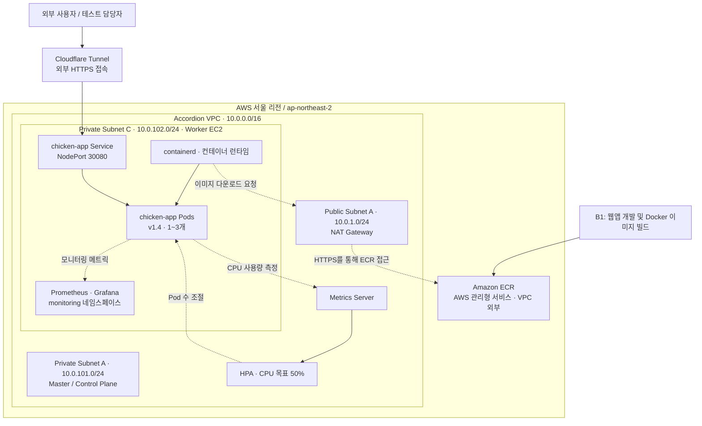

# Accordion — AWS 기반 Kubernetes 웹서비스 자동 확장 및 통합 모니터링

**KT Cloud Infrastructure Bootcamp | 치킨팀 (Chicken Team)**

Terraform으로 AWS 인프라를 구축하고, Docker 컨테이너 기반 웹 애플리케이션을 Kubernetes에 배포한 뒤, **CPU 사용률에 따라 Pod 수를 자동으로 확장·축소하는 시스템**을 구현하는 팀 프로젝트입니다. Prometheus와 Grafana를 활용하여 CPU 사용률, 메모리 사용량, Pod 수 및 클러스터 상태를 시각화하는 것을 목표로 합니다.

> **핵심 시나리오:** 웹앱의 CPU 부하 생성 버튼 실행 → Metrics Server가 CPU 메트릭 제공 → HPA가 Pod를 **1개에서 최대 3개까지 확장** → 부하 감소 후 **1개로 축소** → Grafana에서 변화 과정 확인

## 1. 프로젝트 목표

- **인프라 자동화:** Terraform을 사용하여 AWS VPC, 서브넷, 라우팅, 게이트웨이, 보안 그룹 및 EC2 구성
- **Kubernetes 클러스터 구축:** Private Subnet의 Master 1대와 Worker 1대로 `kubeadm` 기반 클러스터 운영
- **컨테이너 기반 웹서비스 배포:** 웹앱을 Docker 이미지로 빌드하고 Amazon ECR에 저장한 후 Kubernetes에 배포
- **서비스 연결:** Kubernetes NodePort Service(`30080`)를 통해 웹앱 접근
- **자동 확장:** Metrics Server와 HPA(Horizontal Pod Autoscaler)를 사용하여 CPU 사용률에 따라 Pod 수를 1~3개로 조절
- **통합 모니터링:** Prometheus 및 Grafana로 CPU·메모리·Pod 수·클러스터 상태 시각화
- **자동 복구:** 애플리케이션 Pod 삭제 후 Deployment가 새 Pod를 생성하는지 검증

## 2. 구현 현황 (2026-10-20 기준)

| 항목 | 상태 | 확인 결과 및 남은 작업 |
| --- | --- | --- |
| AWS 네트워크 및 Kubernetes 클러스터 | ✅ 완료 | Master·Worker Node 모두 `Ready` 확인 |
| 웹앱 Deployment | ✅ 완료 | ECR 이미지 `accordion-team:v1.4` 배포 및 실행 확인 |
| NodePort Service | ✅ 완료 | `30080` → Service `80` → Container `8080` 연결 확인 |
| Metrics Server | ✅ 완료 | Pod별 CPU·메모리 사용량 조회 정상 |
| HPA 설정 | ✅ 완료 | CPU 목표 50%, 최소 1개, 최대 3개 Pod |
| HPA 자동 확장·축소 | ✅ 검증 | `SuccessfulRescale` 이벤트로 **1 → 3 → 1** 확인 |
| B1 웹앱 ↔ B2 연동 | ✅ 완료 | 팀의 Cloudflare 기반 외부 접속 및 통합 테스트 완료 |
| Prometheus·Grafana 시각화 | 🚧 진행 중 | B3에서 메트릭 수집 및 대시보드 최종 검증 중 |
| Pod 자동 복구(Self-Healing) | ⏳ 예정 | Pod 삭제 후 자동 재생성 테스트 및 결과 기록 필요 |
| 이전 버전 Error Pod 분석 | ⏳ 확인 필요 | 과거 Revision의 Error 상태 Pod 2개 확인, 원인 분석 필요 |
| 최종 발표 자료 및 Git 정리 | ⏳ 예정 | 검증 캡처 정리, AWS B2 작업 트리와 GitHub 이력 정합성 확인 |

**검증 참고:** 최초 HPA 자동 확장 테스트는 웹앱 **v1.3**의 CPU 부하 버튼을 사용했습니다. 이후 **v1.4** 이미지 배포와 HPA 확장·축소 기록을 확인했고, B1–B2 외부 접속 연동 테스트도 진행했습니다. Grafana 시각화와 Pod 자동 복구는 최종 결과를 별도로 확보해야 합니다.

## 3. 전체 시스템 아키텍처



**아키텍처 설명**

- **Amazon ECR(Elastic Container Registry)**은 AWS에서 관리하는 리전 단위 이미지 저장소이므로 **VPC 내부나 EC2·Pod 안에 배치하지 않습니다.** Worker EC2는 NAT Gateway를 통한 외부 HTTPS 경로로 이미지를 가져옵니다.
- **Master EC2**는 Kubernetes Control Plane을 운영하고, **Worker EC2**는 웹앱 및 모니터링 워크로드를 실행합니다. 실제 Pod 위치는 Kubernetes 스케줄링 결과에 따라 달라질 수 있습니다.
- **Cloudflare Tunnel**은 외부 접속 경로로, Deployment나 Service 자체를 대체하지 않습니다. 터널 커넥터의 정확한 실행 위치는 별도로 관리합니다.
- 그림은 **논리적 아키텍처**입니다. HPA는 별도의 웹앱 Pod가 아니라 Kubernetes 컨트롤러 기능으로 동작합니다.

### AWS 인프라 구성

| 항목 | 설정 |
| --- | --- |
| AWS 리전 | `ap-northeast-2` (서울) |
| VPC | `10.0.0.0/16` |
| Public Subnet A | `10.0.1.0/24` · AZ `2a` · NAT Gateway |
| Private Subnet A | `10.0.101.0/24` · AZ `2a` · Master EC2 |
| Private Subnet C | `10.0.102.0/24` · AZ `2c` · Worker EC2 |
| EC2 구성 | Master 1대 + Worker 1대 (고정) |
| 운영체제 | Ubuntu Server 24.04 LTS |
| Kubernetes | v1.36.5 · `kubeadm` |
| 컨테이너 런타임 | containerd |
| CNI(Container Network Interface) | Calico |
| 서버 관리 | AWS Systems Manager Session Manager (SSM) |

## 4. 웹 애플리케이션 및 Kubernetes 구성

### 컨테이너 이미지 배포 흐름

```text
B1 웹 애플리케이션 개발
         ↓
Dockerfile 기반 이미지 빌드
         ↓
Amazon ECR 업로드
         ↓
Kubernetes Deployment에서 이미지 참조
         ↓
Worker EC2의 containerd가 이미지 다운로드 및 실행
         ↓
chicken-app Pod 생성
         ↓
NodePort Service를 통해 웹서비스 제공
```

### 애플리케이션 리소스 설정

| 항목 | 설정값 |
| --- | --- |
| Namespace | `chicken-app` |
| Deployment | `chicken-app` |
| ECR 이미지 | `accordion-team:v1.4` |
| Container Port | `8080` |
| Service 유형 | `NodePort` |
| 포트 연결 | NodePort `30080` → Service `80` → Container `8080` |
| CPU Request / Limit | `100m` / `500m` |
| Memory Request / Limit | `64Mi` / `128Mi` |
| HPA CPU 목표 | `50%` |
| 최소 / 최대 Pod | `1` / `3` |

**CPU Request와 HPA의 관계:** CPU Request를 `100m`로 설정했기 때문에 HPA 목표 사용률 **50%는 Pod당 평균 약 `50m` CPU 사용량**에 해당합니다. 이 50%는 CPU Limit(`500m`)가 아니라 **CPU Request(`100m`)**를 기준으로 계산합니다.

## 5. CPU 부하 및 HPA 자동 확장 시나리오

1. B1 웹앱에 접속하여 **CPU 부하 생성 버튼**을 실행합니다.
2. CPU 부하는 브라우저가 아닌 **웹서버가 실행되는 애플리케이션 Pod**에서 발생합니다.
3. Metrics Server가 CPU 사용량을 수집하여 Kubernetes Metrics API로 제공합니다.
4. HPA는 목표 CPU 사용률 `50%`와 현재 사용률을 비교하여 필요한 Pod 수를 계산합니다.
5. 부하가 충분하면 Deployment가 Pod를 **1개에서 최대 3개까지 자동 확장**합니다.
6. 부하가 감소하면 안정화 시간을 거쳐 Pod 수가 **다시 1개로 축소**됩니다.
7. B3는 Prometheus와 Grafana를 활용하여 CPU 및 Pod 수 변화의 시각화를 검증합니다.

### 실제 검증 기록

- `kubectl top pods`에서 Pod별 CPU 및 메모리 사용량 조회 성공
- CPU 부하 증가 시 HPA의 `SuccessfulRescale` 이벤트로 **New size: 3** 확인
- 부하 감소 시 HPA의 `SuccessfulRescale` 이벤트로 **New size: 1** 확인
- CPU 사용률 `134%/50%`, `71%/50%` 등 목표 초과 상태와 **3개 Replica 유지** 확인
- 부하 종료 후 CPU 사용률 `1%/50%`, **Replica 1개 복귀** 확인
- ECR `v1.4` Deployment가 실행되고, 테스트 시점에 **3/3 Ready** 상태 확인

**v1.4 주의 사항:** `/api/load/start`, `/api/load/stop`은 요청을 받은 **해당 Pod 하나에만 적용**됩니다(`this-pod-only`). CPU 부하는 약 **15초 후 자동 종료**됩니다. Service가 요청을 여러 Pod로 분산하므로 Start와 Stop이 항상 같은 Pod에 도착하는 것은 아닙니다. 짧은 부하의 측정 결과는 Metrics Server와 HPA의 수집·평가 시점에 따라 달라질 수 있습니다.

## 6. 상태 확인 명령어 (조회 전용)

아래 명령어는 Kubernetes 연결이 설정된 Master 또는 관리 터미널에서 실행합니다.

```bash
# Master / Worker Node 상태 확인
kubectl get nodes

# 실제 Deployment 이미지 및 Pod 가용 상태 확인
kubectl -n chicken-app get deployment chicken-app -o wide

# Service 및 NodePort 설정 확인
kubectl -n chicken-app get svc chicken-app -o wide

# 애플리케이션 Pod의 CPU / 메모리 사용량 확인
kubectl top pods -n chicken-app

# HPA 현재 상태 및 자동 확장·축소 이벤트 확인
kubectl -n chicken-app get hpa chicken-app
kubectl -n chicken-app describe hpa chicken-app

# B3 모니터링 Pod 상태 확인
kubectl -n monitoring get pods
```

위 명령어는 **리소스를 수정하지 않는 조회용 명령어**입니다. 단, 모니터링 Pod가 `Running`이라고 해서 Grafana의 데이터 소스와 그래프 쿼리가 모두 정상이라는 뜻은 아닙니다.

### 웹앱 접속 방식

AWS Master/Worker는 Private Subnet에 있으며 공인 IP를 할당하지 않았습니다. Windows에서는 **SSM Session Manager 포트포워딩**을 통해 `http://localhost:30080`으로 접속했고, 팀의 외부 통합 테스트에서는 **Cloudflare Tunnel**을 사용했습니다. 임시 Cloudflare URL은 변경될 수 있으며, CPU 부하 제어 기능을 무분별하게 공개하지 않도록 접근 범위를 관리해야 합니다.

## 7. 저장소 구조

```text
kt-chicken-project/
├── README.md
├── app/                    # B1 웹앱 및 Docker 관련 파일
├── infra/scripts/          # 인프라 / Kubernetes 초기화 스크립트
├── k8s/
│   ├── deployment.yaml     # 애플리케이션 이미지 및 리소스 설정
│   ├── service.yaml        # NodePort Service
│   └── hpa.yaml            # HPA 설정
└── monitoring/             # 모니터링 및 테스트 관련 파일
```

*실제 폴더 내용은 브랜치별로 다를 수 있습니다. 위 Kubernetes Manifest들은 `feature/b2-chicken-integration` 브랜치를 기준으로 정리했습니다.*

## 8. 팀원별 담당 업무

| 구분 | 담당 업무 |
| --- | --- |
| A1 — AWS 네트워크 | VPC, Subnet, 라우팅, NAT/Internet Gateway, Security Group |
| A2 — Terraform | IaC(Infrastructure as Code) 작성 및 AWS 리소스 배포 |
| A3 — Kubernetes 기반 환경 | `kubeadm`, containerd, Calico, Master/Worker 클러스터 구축 |
| B1 — 웹서비스 | 웹앱 개발, Docker 이미지 빌드, ECR 등록, CPU 부하 API 구현 |
| **B2 — Kubernetes 배포 및 HPA** | **Deployment·Service 연동, Metrics Server, HPA 구성 및 부하 테스트 검증** |
| B3 — 모니터링 | Prometheus, Grafana, 대시보드 구성 및 시각화 검증 |

### B2 주요 작업 및 성과

- Kubernetes Deployment의 ECR 이미지 `v1.4` 연동
- NodePort `30080` 및 Service Endpoint 연결 확인
- CPU·메모리 Request/Limit 설정과 HPA CPU 목표값 이해 및 검증
- Metrics Server 정상 동작 확인
- HPA의 자동 확장·축소를 `SuccessfulRescale` 이벤트로 검증
- B1 웹앱의 다중 Pod 환경에서 발생하는 Start/Stop API 동작 특성 확인
- GitHub `feature/b2-chicken-integration` 브랜치에서 이미지 변경 반영 및 Push

## 9. 최종 발표 전 남은 작업

- [ ] **B3:** Grafana 데이터 소스, 메트릭 쿼리 및 CPU/Pod 개수 변화 시각화 완료
- [ ] **B2/팀:** 협의된 시간에 Pod 삭제 → 자동 재생성 **Self-Healing** 테스트 및 증거 확보
- [ ] **B2/A3:** 이전 버전 Error Pod 2개의 원인 확인 및 정리 여부 검토
- [ ] **팀:** 웹앱, HPA 이벤트, Grafana 화면 등 최종 시연 캡처 정리
- [ ] **팀:** 검토가 끝난 README 및 변경 사항을 공유 브랜치에 반영

## 10. 프로젝트 범위

본 프로젝트에서는 **EC2 서버 수를 고정하고 Kubernetes Pod 수만 자동 확장**합니다. 다음 항목은 현재 핵심 구현 범위에서 제외합니다.

- AWS Application Load Balancer(ALB)
- EC2 Auto Scaling Group(ASG)
- Kubernetes Cluster Autoscaler
- k6 기반 부하 테스트 (핵심 부하 테스트는 **B1 웹앱의 자체 CPU 부하 버튼** 사용)

---

**KT Cloud Infrastructure Bootcamp | 치킨팀 Accordion 프로젝트**  
*Terraform 기반 Kubernetes 웹서비스 자동 확장 및 통합 모니터링 시스템 구축*
